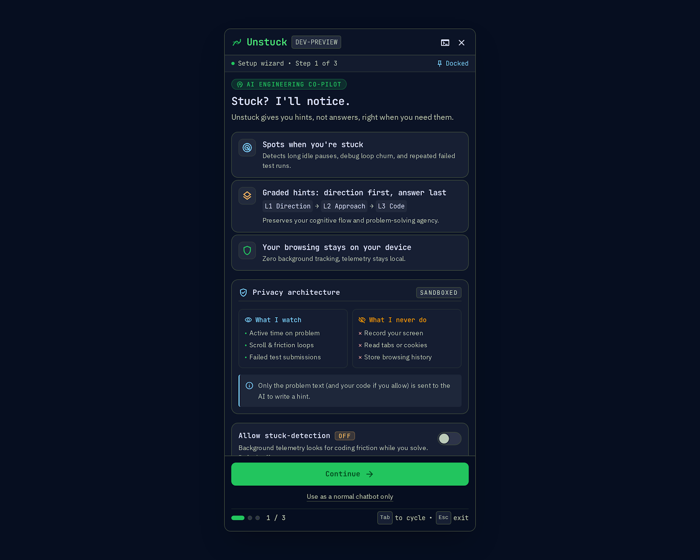
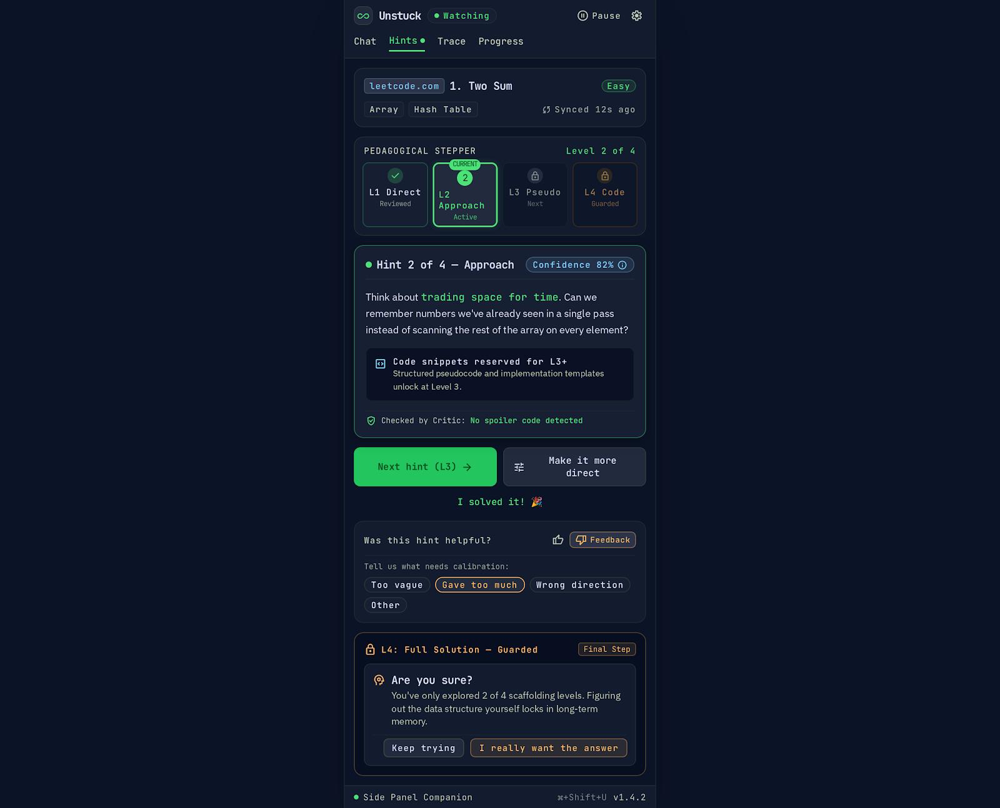
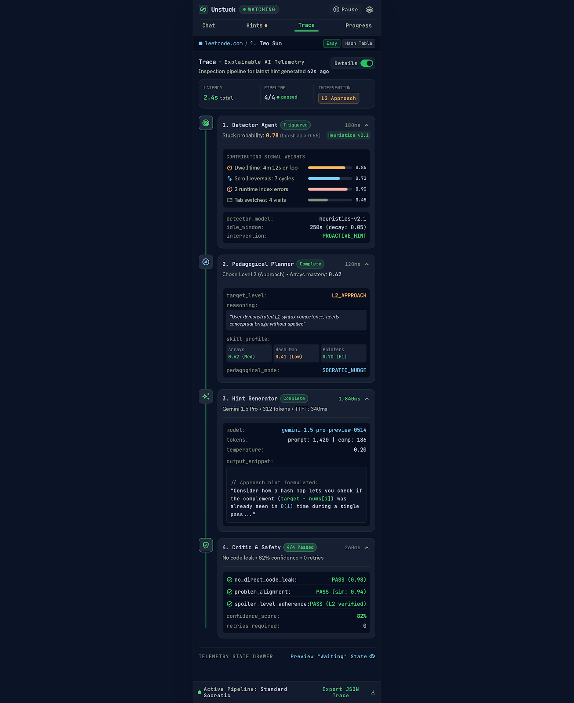
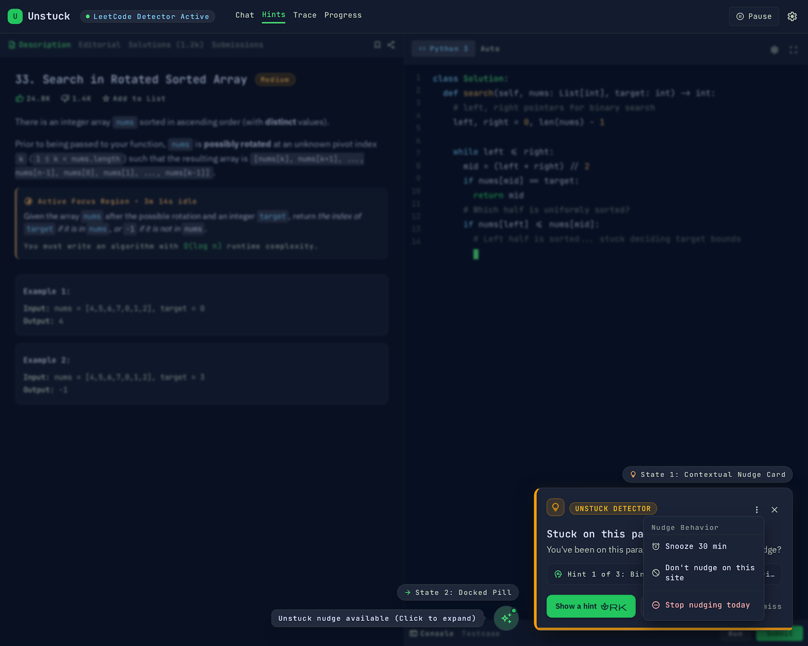
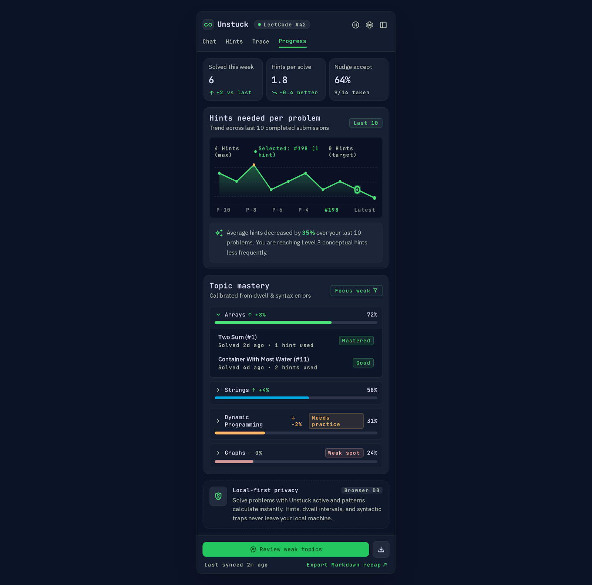
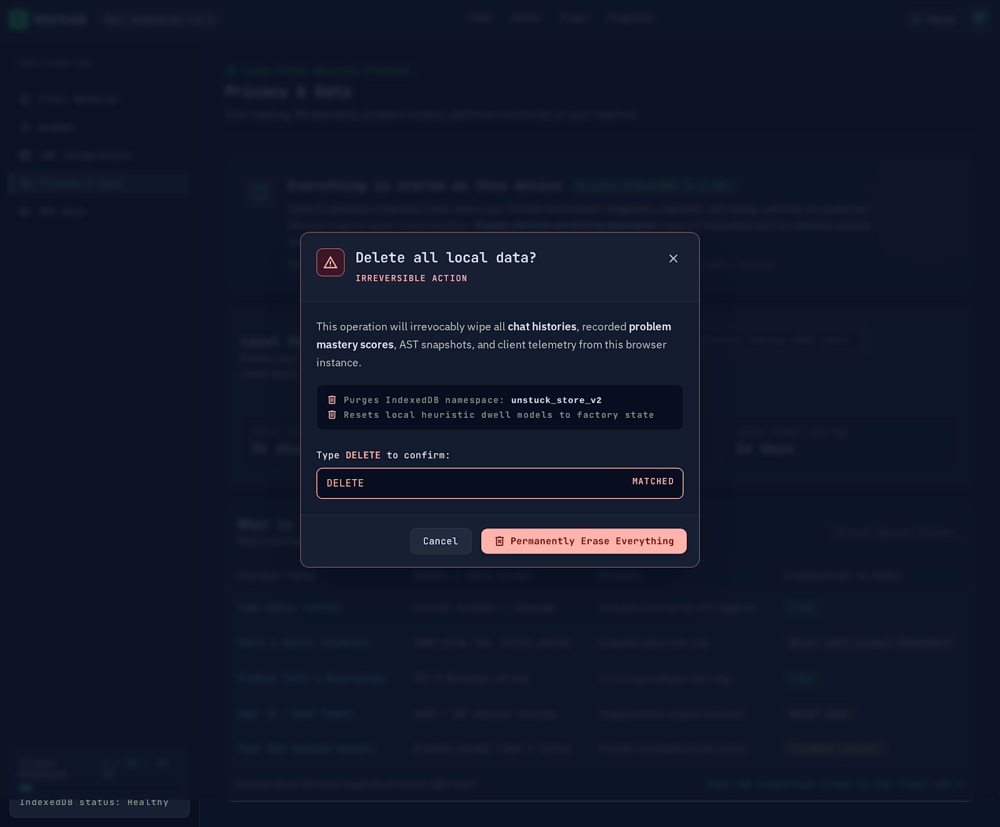

# Unstuck — Proactive, Explainable AI Coding Tutor

[](#)
[](#)
[](#)
[](LICENSE)
[](#)
[](#)

> **Unstuck** is an open-source, local-first Chrome extension that acts as a proactive, pedagogical coding tutor for competitive programming and Data Structures & Algorithms (DSA).
> Rather than functioning as a code-generating chatbot that spoils solutions, Unstuck passively monitors cognitive struggle, decides when an intervention is justified, and dispenses structured, multi-level hints anchored strictly in problem statements.

---

## Key Features

1. **Passive Struggle Detection (Zero Keylogging):**
   - Monitors dwell time, scroll pauses, code edit churn, and wrong submission verdicts without capturing keystroke streams.
   - Calculates real-time stuck probability $P(\text{stuck})$ locally inside the browser.

2. **Contextual Bandit Intervention Policy:**
   - Evaluates whether offering a nudge is worth the cognitive interruption cost.
   - Uses an $\epsilon$-greedy bandit with Bayesian prior decay to adapt to individual user dismissal patterns over time.

3. **4-Tier Pedagogical Scaffolding Ladder:**
   - **Level 1 (Direction):** High-level conceptual nudge anchored in problem statement text. Zero code.
   - **Level 2 (Approach):** Algorithmic pattern and time/space complexity guidance. Zero code.
   - **Level 3 (Pseudocode):** Structural template and logic outline.
   - **Level 4 (Guarded Solution):** Complete implementation protected by an explicit double-confirmation modal to prevent accidental spoilers.

4. **Multi-Agent Critic & Grounding Guardrails:**
   - Every candidate hint is audited by an independent Critic agent before delivery.
   - Inspects for code leakage at L1/L2, verifies statement grounding, and asserts topic relevance. Falls back to deterministic safe hints if verification fails.

5. **Explainability & Telemetry Audit (Trace Tab):**
   - Full glassbox audit trail displaying each pipeline step: generator latency, critic approval verdict, confidence scores, and token usage.

6. **Bayesian Knowledge Tracing (Progress Tab):**
   - Calibrates topic mastery across DSA categories (Arrays, Dynamic Programming, Graphs, etc.) using two-state BKT equations.

7. **Fair-Play Contest Protection:**
   - Automatically detects live contest URLs on LeetCode (`/contest/`) and Codeforces (`/contest/`).
   - Completely silences content script overlays and suspends all model generation requests.

8. **Zero-Backend Privacy (BYOK):**
   - 100% client-side architecture. No proxy servers, analytics databases, or intermediary backends.
   - Uses your personal Google Gemini API key stored strictly in encrypted `chrome.storage.local`.

---

## Visual Walkthrough

| Onboarding & BYOK Setup | Pedagogical Hints Ladder | Explainable AI Trace Tab |
|---|---|---|
|  |  |  |

| Floating Nudge Overlay | Topic Progress (BKT Mastery) | Privacy Data Transparency |
|---|---|---|
|  |  |  |

---

## System Requirements

- **Runtime:** Google Chrome or Chromium-based browser (v114+ recommended for Chrome Side Panel API support).
- **Build Tools:** Node.js `>= 20.0.0`, npm `>= 10.0.0`.
- **Operating System:** Windows, macOS, or Linux.

---

## Installation & Setup

### 1. Build from Source
```bash
# Clone repository
git clone https://github.com/Shreyam007/chatbot_extension.git
cd chatbot_extension

# Install dependencies
npm install

# Compile TypeScript
npm run compile

# Build production extension package
npm run build
```

The unpacked extension files are output to `.output/chrome-mv3`.

### 2. Load Extension in Chrome
1. Open Google Chrome and navigate to `chrome://extensions`.
2. Enable **Developer mode** toggle in the top-right corner.
3. Click **Load unpacked** in the top-left toolbar.
4. Select the `.output/chrome-mv3` folder inside the cloned project.
5. The **Unstuck** icon will appear in your Chrome toolbar.

### 3. Connect Your Gemini API Key (BYOK)
1. Obtain a free API key from [Google AI Studio](https://aistudio.google.com/).
2. Click the Unstuck toolbar popup icon and select **Settings** (or open the onboarding wizard).
3. Paste your API key into the **AI Provider** tab.
4. Click **Test API Key**. Upon successful validation, the key is saved directly into `chrome.storage.local`.

---

## Demo Mode

For evaluation and testing without waiting for standard 15-minute cooldown timers, enable **Demo Mode**:
1. Open **Options** (`chrome-extension://<id>/options.html#advanced`) or inspect Settings.
2. Toggle **Demo Mode (Fast Cooldowns)** to **ON**.
3. When enabled:
   - Dwell detection threshold shortens from 5 minutes to 20 seconds.
   - Nudge cooldown shortens to 20 seconds.
   - Distinct badges (`DEMO (20s)`) appear in the Side Panel header and toolbar popup.

---

## Privacy Summary: What is Sent to the AI

Unstuck adheres to strict client-side data minimization:

| Field | Sent to Gemini? | Purpose / Justification |
|---|---|---|
| **Problem Title & Slug** | **Yes** | Anchors the tutor to the specific problem context. |
| **Problem Statement Text** | **Yes** | Allows grounding verification and topic extraction. |
| **Detected Problem Tags** | **Yes** | Calibrates hints to the primary data structure/algorithm. |
| **Current Target Hint Level** | **Yes** | Enforces pedagogical scaffolding tier (L1 to L4). |
| **User Code Editor Buffer** | **Optional** (Default: OFF) | Only included if the user explicitly enables "Include my code" consent in settings. |
| **Keystroke Streams / Timestamps** | **NO** | Never collected or transmitted. |
| **Browsing History / Other Tabs** | **NO** | Unstuck only executes on allowed coding domains. |
| **API Key** | **Direct to Google** | Communicates directly with `generativelanguage.googleapis.com` via HTTPS. |

Users can view audit metrics, export their complete history as JSON/CSV/Markdown, or execute a complete cryptographically clean wipe of all IndexedDB and Chrome Storage records at any time.

---

## Project Structure

```
├── assets/                 # Vector logo source and rasterized icons
├── docs/                   # Engineering specs, architecture, permissions, and defense notes
│   ├── ARCHITECTURE.md     # Deep architecture, multi-agent graphs, message bus
│   ├── DECISIONS.md        # Architecture Decision Records (ADRs 1–18)
│   ├── EDGE_CASES.md       # Edge cases catalog (60 automated, 2 manual)
│   ├── EVALUATION.md       # Offline Critic benchmark and harness methodology
│   ├── MANUAL_QA.md        # Comprehensive real-Chrome manual QA script
│   ├── PERMISSIONS.md      # Manifest V3 permission justifications
│   ├── PRIVACY.md          # Plain-language privacy disclosure
│   └── VIVA_NOTES.md       # 5-minute live demo script and 30+ Q&A viva defense
├── entrypoints/            # WXT extension entrypoints (background, content, popup, sidepanel, options)
├── public/                 # Static extension assets (icons, manifest fixtures)
├── scripts/                # Benchmark, packaging, and credential scanning utilities
├── src/
│   ├── background/         # Service worker, multi-agent graph, bandit planner, BKT mastery
│   ├── content/            # Signal collectors, DOM adapters (LeetCode, Codeforces), Shadow DOM overlay
│   ├── options/            # Settings dashboard (Provider, Nudges, Privacy, Advanced)
│   ├── popup/              # Toolbar popup UI (Quick actions, telemetry overview)
│   ├── shared/             # Zod schemas, typed message bus, contracts
│   ├── sidepanel/          # Native Side Panel app (Hints, Chat, Trace, Progress)
│   └── ui/                 # Design token system, ErrorBoundary, components
└── tests/
    ├── e2e/                # Playwright E2E suites (9 full scenarios, packaged smoke test)
    ├── fixtures/           # Offline DOM fixtures for automated testing
    └── unit/               # Vitest unit test suite (38 test files, 267 tests)
```

---

## Available Scripts

| Command | Purpose |
|---|---|
| `npm run compile` | Runs TypeScript typechecker (`tsc --noEmit`). |
| `npm run lint` | Runs ESLint across all source and test files. |
| `npm test` | Runs the complete Vitest unit test suite (38 files, 267 tests). |
| `npm run test:e2e` | Runs Playwright E2E test scenarios in Chromium. |
| `npm run build` | Builds the production extension package using WXT + Vite. |
| `npm run zip` | Packages `.output/chrome-mv3` into `.output/unstuck-1.0.0-chrome.zip`. |
| `npm run eval` | Executes the offline Critic verification benchmark across 15 DSA problems. |
| `npm run eval:live` | Runs live evaluation against the active Google Gemini API. |
| `npm run security:scan`| Audits repository and git history for accidentally staged credentials. |

---

## Honest Limitations

1. **Behavioral Proxy for Intent:** Dwell time and code churn are heuristic proxies for cognitive struggle. A user pausing to consult a textbook may look identical to a user daydreaming.
2. **Provider Constraints:** Generative hint generation depends on Google Gemini availability and is subject to provider rate limits (HTTP 429) and network latency.
3. **Synthetic Benchmarks vs. Classroom Studies:** Benchmark results demonstrate algorithmic compliance and critic filtering in synthetic environments, not a longitudinal human learning study.

---

## Troubleshooting

- **Invalid API Key (S13.1):** Verify that your API key is active in [Google AI Studio](https://aistudio.google.com/) and that the Gemini API is enabled for your project.
- **Quota Exceeded (HTTP 429 / S13.3):** Free-tier Gemini accounts have a 15 RPM limit. The extension displays a live countdown timer until the quota window resets.
- **Side Panel Fails to Open:** Ensure Chrome is updated to version 114+ and that the Side Panel is enabled in your browser settings.
- **Context Invalidation After Reload:** If you reload the extension in `chrome://extensions`, refresh open LeetCode/Codeforces problem tabs to reconnect content script communication channels.

---

## License

This project is licensed under the [MIT License](LICENSE) — Copyright © 2026 Shreyam Pandey.
