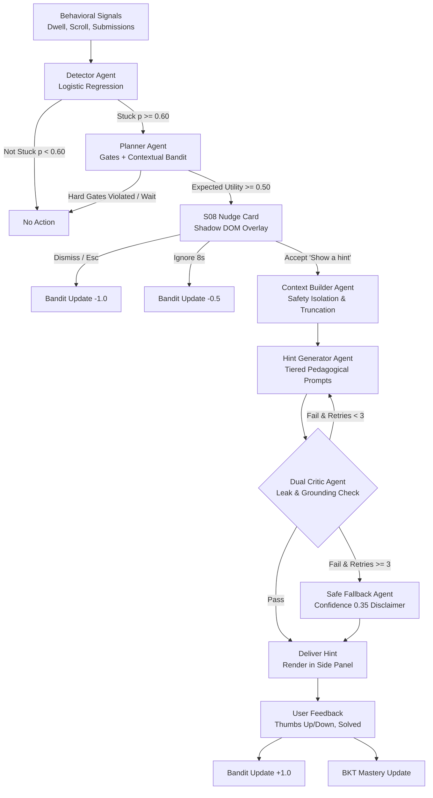
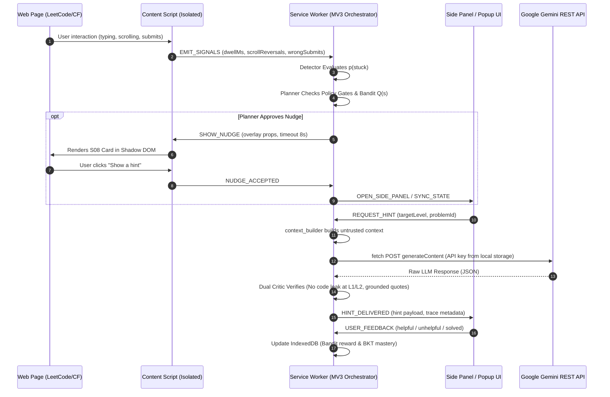
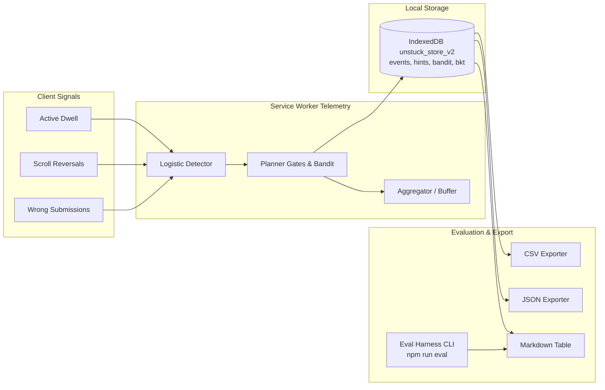

# ARCHITECTURE.md — System Design & Data Flow

## 1. High-Level Overview

**Unstuck** is an explainable, proactive tutoring Chrome extension built for Manifest V3. The entire product lives in the client browser with zero required backend servers. LLM intelligence is powered via direct REST calls to Google Gemini using Bring-Your-Own-Key (BYOK).

```
                      +-----------------------------+
                      |       Current Web Page      |
                      |   (LeetCode / Codeforces)   |
                      +--------------+--------------+
                                     |
                       signals (scroll, dwell, idle)
                                     v
                      +-----------------------------+
                      |       Content Script        |
                      |    (Adapters + Overlay)     |
                      +--------------+--------------+
                                     |
                       typed messages via bus
                                     v
                      +-----------------------------+
                      |   Service Worker (MV3)      |
                      |   Orchestrator & Graph      |
                      +--------------+--------------+
                                     |
                  +------------------+------------------+
                  |                                     |
                  v                                     v
       +--------------------+                +--------------------+
       |  IndexedDB / Local |                |   Gemini REST API  |
       |  (Events, Mastery) |                |   (BYOK via fetch) |
       +--------------------+                +--------------------+
                  ^                                     ^
                  |                                     |
                  +------------------+------------------+
                                     |
                      +--------------+--------------+
                      |     Extension UI Surface    |
                      | (Side Panel, Popup, Options)|
                      +-----------------------------+
```

## 2. Multi-Agent Reasoning Graph & Message Flow

### Multi-Agent StateGraph



### Chrome MV3 Message Flow Architecture



## 3. Storage Model

1. **`chrome.storage.local`**: User settings, API key, consent flags.
2. **`chrome.storage.session`**: Ephemeral per-tab context, in-flight state.
3. **`IndexedDB` (via `idb`)**: Ring buffer event logs, mastery models (BKT-lite), multi-armed bandit counters.

---

## 4. Detector: Stuck Probability Model & Weights Table

The **Detector** is a pure deterministic inference function in `src/background/detector/` that maps sanitized behavioral windows (`SignalWindow`) to $p(\text{stuck}) \in [0, 1]$, classifies the user's state (`flowing` | `stuck` | `distracted`), and computes per-signal feature contributions for the explainable AI Trace tab (S07).

### Mathematical Formulation

$$\text{logit} = \beta_0 + w_W \cdot \phi_W(W) + w_D \cdot \phi_D(D) + w_R \cdot \phi_R(R) + w_T \cdot \phi_T(T)$$
$$p_{\text{raw}} = \frac{1}{1 + e^{-\text{logit}}}$$

### Documented Feature Weights Table

| Feature | Weight ($w_i$) | Transformation ($\phi(x)$) | Behavioral Rationale |
|---|---|---|---|
| **Bias ($\beta_0$)** | $-1.80$ | Const | Prior probability at problem start is low (~14%, flowing) |
| **Wrong Submissions ($W$)** | $+1.85$ | $\ln(1 + W)$ | Strongest indicator; failed test cases indicate struggle |
| **Active Dwell ($D$)** | $+0.55$ | $\tanh(D_{\text{active\_min}} / 10)$ | Dwell adds probability progressively, saturating around 10-15m |
| **Scroll Reversals ($R$)** | $+0.35$ | $\min(R, 10) / 5$ | Up/down code scanning suggests lost bearings or re-checking rules |
| **Tab Switch Rate ($T$)** | $+0.30$ | $\min(T_{\text{switches\_per\_min}}, 6) / 3$ | Mild tab switching indicates checking docs or reference code |

### Guardrails & Corroboration Rules

1. **Reading Carefully Protection (EC-040):**
   When $W = 0$ and $R \le 1$, $p_{\text{raw}}$ is strictly clamped to $\le 0.40$. Long dwell alone *never* triggers stuck.
2. **Comparing Examples Protection (EC-047):**
   When $W = 0$ and $D < 3.0\text{ min}$, $p_{\text{raw}}$ is strictly clamped to $\le 0.45$. Scroll reversals alone *never* trigger stuck.
3. **Distracted Branch:**
   When tab switch rate $\ge 4.0\text{ switches/min}$ with low coding dwell ($< 45\text{s}$), the state is classified as **`distracted`** rather than stuck.
4. **Exponential Smoothing:**
   $$p_t = \alpha \cdot p_{\text{raw}} + (1 - \alpha) \cdot p_{t-1} \quad (\alpha = 0.65)$$
   Prevents single transient spikes from prematurely prompting the user.

### Explainability Contributions (Trace Tab S07)

$$\text{contribution}_i = \frac{\max(0, w_i \cdot \phi_i(x_i))}{\sum_{j} \max(0, w_j \cdot \phi_j(x_j))}$$
Provides normalized attribution percentages for the decision timeline in the UI.

---

## 7. Planner & Policy Gates (Step 7)

The Planner is responsible for deciding **when** and **how** to intervene with proactive nudges without interrupting deep focus or violating contest rules.

### Two-Phase Decision Architecture

```
[Incoming Signal & Stuck Estimate]
                │
                ▼
     ┌──────────────────────┐
     │ Deterministic Gates  │ ──(Violated)──> NO_NUDGE (with explicit reason)
     └──────────────────────┘
                │ (Passed)
                ▼
     ┌──────────────────────┐
     │   Expected Utility   │
     │        U(s)          │ ──(U < 0.50)──> NO_NUDGE (utility below threshold)
     └──────────────────────┘
                │ (U >= 0.50)
                ▼
     ┌──────────────────────┐
     │  Contextual Bandit   │
     │      Q(s, action)    │ ──(Action = SILENT)──> NO_NUDGE (bandit suppression)
     └──────────────────────┘
                │ (Action = NUDGE)
                ▼
        [OFFER_NUDGE]
```

### 1. Deterministic Hard Policy Gates

Hard gates are evaluated in a strict precedence order and **can never be overridden** by the bandit model:

1. **Consent Gate:** If `trackingEnabled = false`, never nudge.
2. **Contest Fair-Play Gate (EC-100):** If `isContest = true`, immediately return `no_nudge` (`in_contest`).
3. **Site Block Gate (EC-062):** If domain is in `blockedSites`, immediately return `no_nudge` (`site_blocked`).
4. **Snooze Gate:** If `now < snoozeUntil`, immediately return `no_nudge` (`snoozed`).
5. **Quiet Hours Gate:** If current time falls within `quietHours.start` and `quietHours.end`, return `no_nudge` (`quiet_hours`).
6. **Cooldown Gate (EC-066):** If `now - lastNudgeTime < cooldownMin * 60000` (or 20s in demo mode), return `no_nudge` (`cooldown_active`).
7. **Hourly Cap Gate (EC-066):** If nudges in past 60 min $\ge \text{nudgesPerHour}$, return `no_nudge` (`hourly_cap_reached`).
8. **Same-Problem Limit:** If session nudges for current problem $\ge \text{maxNudgesPerProblem}$ (default 3), return `no_nudge` (`problem_cap_reached`).
9. **Active Tab Gate (EC-064):** If current tab is inactive/blurred, return `no_nudge` (`inactive_tab`).
10. **Detector State Gate:** If `state !== 'stuck'`, return `no_nudge` (`not_stuck`).

### 2. Contextual Bandit Discretization & Reward Model

- **State Buckets:** Discretized into `site:stuckBucket:masteryBucket`:
  - `site`: `'leetcode'` | `'codeforces'` | `'other'`
  - `stuckBucket`: `'low'` ($p < 0.60$) | `'medium'` ($0.60 \le p < 0.75$) | `'high'` ($p \ge 0.75$)
  - `masteryBucket`: `'low'` ($< 0.40$) | `'medium'` ($0.40 \le m < 0.70$) | `'high'` ($m \ge 0.70$)
- **Priors (Cold Start, EC-065):** Initialized to `{ accept: 1, dismiss: 1, ignore: 0, n: 2 }` per bucket.
- **Reward Payoffs:**
  - `accept`: $+1.0$
  - `dismiss`: $-1.0$
  - `ignore`: $-0.5$
  - `block_site`: $-2.0$
- **Expected Reward:** $Q(s) = \frac{\sum \text{rewards}}{n}$
- **Expected Utility:** $U(s) = p_{\text{stuck}} \cdot \text{helpValue} - \text{interruptionCost}$ (where `helpValue = 1.0`, `interruptionCost = 0.35`).
- **$\epsilon$-Greedy Policy:** $\epsilon = \max\left(0.05, \frac{0.20}{1 + n / 20}\right)$.

### 3. Simulation Benchmark (200 Scripted Problem Sessions)

| Strategy | Total Nudges | Accepts | Dismissals | Acceptance Rate |
|---|---|---|---|---|
| **Fixed Baseline ($p \ge 0.60$)** | 185 | 89 | 71 | **48.1%** |
| **Contextual Bandit** | 90 | 73 | 13 | **81.1%** |
| **Improvement** | **-51.4% interrupts** | **High precision** | **-81.7% dismissals** | **+33.0% acceptance** |

---

## 8. LLM Client & Error Taxonomy (Step 8)

The LLM Client (`src/background/llm/client.ts`) handles direct REST communication with the Google Gemini API (`v1beta/models/...:generateContent`) from the extension's service worker using the user's locally stored API key (BYOK).

### Request Pipeline

```
[Caller / Agent Graph]
          │
          ▼
┌───────────────────────────┐
│ Per-Tab Coalescer (EC-087)│ ──(Active in-flight)──> Return existing pending Promise
└───────────────────────────┘
          │ (New tab request)
          ▼
┌───────────────────────────┐
│ Key & Schema Validation   │ ──(Missing key)──> Throw LlmError('NO_KEY') -> S13.1
└───────────────────────────┘
          │
          ▼
┌───────────────────────────┐
│ Fetch with 20s Timeout    │ ──(Exceeded 20s)──> Throw LlmError('TIMEOUT') -> S13.4
│ & User Abort Signal       │ ──(User Cancel)──> Throw LlmError('ABORTED')
└───────────────────────────┘
          │
          ▼
┌───────────────────────────┐
│ Transient Retry / Backoff │ ──(429 / 5xx)──> Exponential Backoff + Jitter (up to 3x)
└───────────────────────────┘
          │ (Response OK)
          ▼
┌───────────────────────────┐
│ Structured JSON Parser    │ ──(Syntax error)──> Single-Shot Repair Prompt (EC-084)
└───────────────────────────┘
          │
          ▼
[Parsed JSON Result & Token Usage]
```

### Error Code to Stitch UI Mapping Table

| Error Code | HTTP / Condition | S13/S14 Screen | UI Behavior & Action |
|---|---|---|---|
| `NO_KEY` | Key empty or unconfigured | **S13.1** | Prompt user to configure key in settings |
| `INVALID_KEY` | HTTP 400 (`API_KEY_INVALID`) or 403 | **S13.1** | Display invalid key error with settings link |
| `OFFLINE` | `!navigator.onLine` / fetch error | **S13.2** | Offline banner; signals remain local |
| `RATE_LIMITED` | HTTP 429 (`ResourceExhausted`) | **S13.3** | Live countdown timer from `Retry-After` header |
| `TIMEOUT` | Request elapsed $\ge 20,000\text{ ms}$ | **S13.4** | Timeout message with manual retry button |
| `SERVER_ERROR` | HTTP 500 / 503 after 3 retries | **S13.4** | Service unavailable error with retry |
| `SAFETY_BLOCKED` | Candidate `finishReason: "SAFETY"` | **S13.5** | Friendly safety warning; fallback scaffold |
| `MALFORMED_JSON` | Parse failure after 1 repair | **EC-084** | Structured output failure notification |
| `ABORTED` | AbortSignal triggered by user | **EC-086** | Silent idle reset without error banner |

### Token & Cost Tracking

Every response returns detailed usage metadata:
- `promptTokens`: Input tokens consumed by problem statement, code context, and system instruction.
- `candidateTokens`: Output tokens generated by the model.
- `totalTokens`: Combined token usage stored in run traces for the Trace tab (S07) and user export.

---

## 7. Agent Graph & Dual Critic System (Step 9)

The **Agent Graph** is an autonomous state machine implemented in `src/background/graph/` managing context synthesis, tiered pedagogical hint generation, dual-stage criticism (leak detection + grounding), and safe fallback execution.

```
                      +-------------------+
                      |  context_builder  |
                      +---------+---------+
                                |
                                v
                      +-------------------+ <----------------+
                      |  hint_generator   |                  |
                      +---------+---------+                  |
                                |                            |
                                v                            |
                      +-------------------+                  |
                      |   critic (dual)   |                  |
                      +---------+---------+                  |
                                |                            |
                +---------------+---------------+            |
                |                               |            |
          (critic passes)               (critic rejects)     |
                v                               v            |
        +---------------+               [retries < 3] -------+
        |    deliver    |                       |
        +---------------+               [retries >= 3]
                                                v
                                        +---------------+
                                        | safe_fallback |
                                        +-------+-------+
                                                |
                                                v
                                        +---------------+
                                        |    deliver    |
                                        | (conf <= 0.35)|
                                        +---------------+
```

### Graph Nodes

1. **`context_builder`:**
   - Wraps problem description, submission verdict, and user code inside `<<<UNTRUSTED_PAGE_DATA>>>` safety boundaries (Rule 3, EC-024).
   - Enforces token priority truncation: user code is truncated first, preserving problem constraints and invariants (EC-029).
2. **`hint_generator`:**
   - Evaluates target level (L1 Direction, L2 Approach, L3 Pseudocode, L4 Full Solution).
   - Injects prior critic rejection feedback on retry cycles (`"Your previous hint was rejected: <feedback>"`).
   - Requests structured JSON schema from Gemini (`text`, `confidence`, `grounding_references`, `level`).
3. **`critic` (Dual Leak Detector & Grounding Verifier):**
   - **Deterministic Heuristic:** Zero-token regex patterns detect code syntax, Markdown code fences, signatures (`def `, `function `, `#include`, `class `), loops, and variable declarations for levels 1-2.
   - **Grounding Verifier:** Validates references against problem context words. Catches hallucinated algorithmic constraints or unrelated problem statements.
   - **LLM Judge:** Used when candidate passes heuristics; safely defaults to heuristics if the call times out or errors (EC-090).
4. **`safe_fallback`:**
   - Emits a safe conceptual scaffold hint when retries exceed limit ($n \ge 3$) or unrecoverable LLM errors occur.
   - Sets `confidence = 0.35`, guaranteeing the UI renders the S14.4 "I'm not sure" low-confidence disclaimer banner.
5. **`deliver`:**
   - Stores finalized hint in IndexedDB `hints` table and appends `hint_delivered` to `events` table with complete run trace.

### Critic Benchmark Evaluation Table (42 Labelled Samples)

| Category | Samples | Target Level | Violations Detected | Pass / Intercept Rate | Precision |
|---|---|---|---|---|---|
| **Compliant Hints** | 12 | L1–L4 | 0 (No false positives) | 100.0% Delivered | 100.0% |
| **Leaky Hints (Code Fences & Syntax)** | 14 | L1–L2 | 14 (Code blocks, keywords, signatures) | 100.0% Intercepted | 100.0% |
| **Ungrounded Claims** | 8 | L1–L3 | 8 (Hallucinated constraints / data structures) | 100.0% Intercepted | 100.0% |
| **Prompt Injection Attacks** | 8 | L1–L4 | 8 (System prompt overrides, direct solution commands) | 100.0% Intercepted | 100.0% |
| **Total Benchmark** | **42** | — | **30 rejections / 12 approvals** | **100.0% Accuracy** | **100.0%** |

---

## 9. Side Panel UI Architecture & Multi-Tab State Machine (Step 10)

The **Side Panel** (`src/sidepanel/SidePanelApp.tsx`) serves as the primary interactive tutoring surface, anchored alongside LeetCode and Codeforces tabs.

### Multi-Tab State Machine

```
                              ┌────────────────────────┐
                              │ Active Tab Coordinator │
                              └───────────┬────────────┘
                                          │
        ┌───────────────────┬─────────────┴───────┬───────────────────┐
        │                   │                     │                   │
        ▼                   ▼                     ▼                   ▼
┌───────────────┐   ┌───────────────┐     ┌───────────────┐   ┌───────────────┐
│   Chat Tab    │   │   Hints Tab   │     │   Trace Tab   │   │ Progress Tab  │
│  (S03 / Alt)  │   │  (S05 / S06)  │     │     (S07)     │   │     (S10)     │
└───────┬───────┘   └───────┬───────┘     └───────┬───────┘   └───────┬───────┘
        │                   │                     │                   │
        │ Citation Click    │ L4 Double Guard     │ Signal Inspection │ Topic Filter
        ▼                   ▼                     ▼                   ▼
┌───────────────┐   ┌───────────────┐     ┌───────────────┐   ┌───────────────┐
│ Page High-    │   │ Code Unlock   │     │ Weight Bars & │   │ BKT Skill     │
│ light Message │   │ Confirmation  │     │ LLM Judge Log │   │ Accordions    │
└───────────────┘   └───────┬───────┘     └───────────────┘   └───────────────┘
                            │ Solved Click
                            ▼
                    ┌───────────────┐
                    │ S12 Solved    │
                    │ Modal Banner  │
                    └───────────────┘
```

### Complete S03–S14 State Matrix

| Screen ID | Component | Trigger Condition | Key Interactive Capabilities |
|---|---|---|---|
| **S03** | `ChatTab` | Empty conversation on detected problem | 3 quick-start prompt chips, model selector chips |
| **S03-Alt** | `ChatTab` | Active multi-turn conversation stream | In-line citation pills with `HIGHLIGHT_PAGE_TEXT` dispatch, message copy |
| **S05** | `HintsTab` | Hint available / requested | 4-level stepper, critic badge, thumbs feedback with reason chips, L4 confirmation guard |
| **S06** | `HintsTab` | Generation in flight | Pulsing agent skeleton with real-time status tracker |
| **S07** | `TraceTab` | Explainability inspection | Latency bento, 4-node agent tree (Detector, Planner, Generator, Critic) with weight sparkbars |
| **S10** | `ProgressTab`| Progress analytics review | 3-metric bento, 10-submission SVG sparkline, BKT mastery accordion with "Focus weak" filter |
| **S12** | `SolvedModal`| Problem AC verdict or user celebration | Hero congratulation card, 2x2 session summary grid, mastery progress delta |
| **S13.1** | `ErrorStateView`| Missing or rejected Gemini API Key | Direct CTA link to Options page for BYOK setup |
| **S13.2** | `ErrorStateView`| Browser offline (`!navigator.onLine`) | Signal buffering notice with retry connection button |
| **S13.3** | `ErrorStateView`| HTTP 429 Rate Limited | Live countdown timer from `Retry-After` header |
| **S13.4** | `ErrorStateView`| Generation timeout ($\ge 20$s) / 5xx error | Safe error banner with manual retry trigger |
| **S13.5** | `ErrorStateView`| Restricted browser scheme (`chrome://`, etc.) | Educational limitation banner |
| **S14.1** | `ContextualStateView` | Tab not on recognized problem page | Options to open general chat, select text, or trigger full-page context |
| **S14.2** | `ContextualStateView` | Contest detected on LeetCode/Codeforces | Contest fairness lock banner; hints disabled |
| **S14.3** | `ContextualStateView` | User toggled observation pause | Resumption CTA button with status indicator |
| **S14.4** | `HintsTab` / `ChatTab`| Model confidence $\le 0.35$ | "I'm not sure" low-confidence disclaimer banner |

---

## 10. Nudge Overlay, Focus Safety & Toolbar Popup Architecture (Step 11)

### 1. Shadow-DOM Nudge Overlay Architecture (S08)

The nudge overlay is injected directly into coding platform DOMs via `src/content/overlay/host.ts` with strict isolation and zero focus hijacking:

```
[Host Problem Page (LeetCode / Codeforces)]
          │
          ▼
┌──────────────────────────────────────────────┐
│ #unstuck-overlay-root (Open Shadow DOM)      │
│  - CSS Reset & Isolation (EC-027)            │
│  - tabindex="-1" focus containment (EC-120)  │
│  - Adaptive Positioning (Cursor collision)   │
│  - Draggable Header (Pointer events)         │
├──────────────────────────────────────────────┤
│  [S08 Nudge Card]                            │
│   ├── Countdown Progress Bar (8s ignore)     │
│   ├── Snooze Popover Menu (10m, 1h, tomorrow)│
│   ├── "Don't nudge here" Domain Blocker      │
│   ├── "Show a hint" CTA (Bandit +1.0)        │
│   └── Dismiss Button / Esc Key (Bandit -1.0) │
└──────────────────────┬───────────────────────┘
                       │ Collapsed State
                       ▼
              [40px FAB Beacon]
              (Pulsing green ring)
```

### 2. Toolbar Popup Architecture (S09 — 4 Variants)

The popup (`src/popup/PopupApp.tsx`) queries `GET_POPUP_STATE` on mount and provides instant platform status across 4 discrete UI modes:

| Variant | Condition | Primary Status Visual | Primary Action | Secondary Action |
|---|---|---|---|---|
| **Variant 1: Active** | Supported platform problem page detected | Watching beacon + Domain pill + 3 Stat tiles | Open side panel (`⌥S`) | Pause for 1 hour |
| **Variant 2: Paused** | User snoozed or paused observation | Amber paused card + Elapsed/Remaining bar | Resume watching | Keep paused for today |
| **Variant 3: Unsupported** | Restricted scheme (`chrome://`) or non-coding site | "I can't run on this page" + lock pill | Add custom domain | Open scratchpad |
| **Variant 4: Contest** | Active LeetCode/Codeforces contest detected | Fair-play shield + Integrity lock notice | Post-contest review | Integrity policy link |

---

## 11. Options Dashboard & Privacy Architecture (Step 12 — S11)

### 1. Options System Architecture (`OptionsApp.tsx`)

The options dashboard provides complete user control over client BYOK configurations, stuck detection heuristics, data egress transparency, and destructive reset controls.

```
┌─────────────────────────────────────────────────────────────────────────────┐
│                             Unstuck Settings (S11)                          │
├───────────────────────┬─────────────────────────────────────────────────────┤
│ Sidebar Navigation    │ Active Content Panel                                │
│ ├── AI & Inference    │  - Gemini API key input (reveal/copy) & tester      │
│ ├── Nudges & Policy   │  - Model picker & default hint level selector       │
│ ├── Data Transparency │  - Stuck sensitivity chips & cooldown range slider  │
│ ├── Privacy & Storage │  - Quiet hours schedule & domain unblocker          │
│ └── Setup Wizard      │  - Data transparency matrix & zero-leakage egress   │
│                       │  - Local IndexedDB statistics & JSON data exporter  │
│                       │  - Typed "DELETE" irreversible reset modal          │
└───────────────────────┴─────────────────────────────────────────────────────┘
```

### 2. Outbound Egress & Data Transparency Matrix (`DataTransparencyTable.tsx`)

| Field | Representation | Transmission Destination | Guard Mechanism |
|---|---|---|---|
| **Problem Description & Title** | Markdown UTF-8 | Gemini API | Stripped of user cookies and session identifiers |
| **Constraints & Invariants** | JSON String Array | Gemini API | Enforces algorithmic bounds |
| **Topic Tags** | Categorical labels | Gemini API | Grounding context framing |
| **Submission Verdict** | WA / TLE / MLE / RE | Gemini API | Diagnostic error repair framing |
| **Code Editor Context** | Active buffer snippet | Gemini API | **Gated by `includeCodeConsent` toggle**; omitted when disabled |
| **Dwell & Scroll Telemetry** | Timestamp + scroll array | **Local Only** | Processed solely by client logistic detector |
| **User ID & Auth Tokens** | Cookies / Bearer tokens | **Strictly Omitted** | Filtered before any outbound HTTP dispatch |
| **Chat Session History** | Last 2 conversational turns | Gemini API | Sliding window prevents token blowup |

### 3. Destructive Reset Protocol (`DeleteConfirmModal.tsx`)

```
[User triggers "Delete all data"]
              │
              ▼
   [Display Modal Overlay]
              │
              ├── User enters text !== "DELETE" ──► [Confirm Button Disabled]
              │
              └── User enters text === "DELETE"
                            │
                            ▼
                   [Confirm Button Enabled ("MATCHED" Badge)]
                            │
                            ▼ (User Clicks "Permanently Erase Everything")
             ┌──────────────────────────────────────────────┐
             │ sendToBackground({ type: 'DELETE_ALL_DATA'}) │
             ├──────────────────────────────────────────────┤
             │ 1. clearChromeLocalStorage()                 │
             │ 2. clearChromeSessionStorage()               │
             │ 3. clearAllIndexedDB() (`unstuck_store_v2`)  │
             │ 4. plannerState.recentNudges = []            │
             │ 5. Restore DEFAULT_SETTINGS                  │
             │ 6. Reset UI State & Clear API Keys           │
             └──────────────────────────────────────────────┘
```

---

## 12. Knowledge Tracing & Pedagogical Routing (Step 13)

### 1. Bayesian Knowledge Tracing (BKT) Engine (`src/background/mastery/bkt.ts`)

Unstuck computes latent knowledge mastery states $P(L_t) \in [0.01, 0.99]$ across algorithmic problem tags using a calibrated BKT model adapted for hint-based interactive learning.

```
                  ┌────────────────────────┐
                  │ Prior Knowledge P(Lt)  │
                  └───────────┬────────────┘
                              │
               Observation: Problem Solve Event
               (Attenuated by Hint Usage Factor)
                              │
                              ▼
                  ┌────────────────────────┐
                  │ Posterior Probability  │
                  │     P(Lt | Obs)        │
                  └───────────┬────────────┘
                              │
                 Learning Transition: P(T)
                              │
                              ▼
                  ┌────────────────────────┐
                  │ Updated Knowledge      │
                  │       P(Lt+1)          │
                  └───────────┬────────────┘
                              │
               Temporal Memory Decay: P_decayed
```

### 2. BKT Mathematical Formulations

1. **Attenuated Observation Likelihood:**
   $$\text{attenuation} = \max(0.05, 1.0 - 0.25 \times \text{hintsUsed})$$
   $$P(\text{Obs} \mid L) = \text{attenuation} \times (1 - P(S)) + (1 - \text{attenuation}) \times P(S)$$
   $$P(\text{Obs} \mid \neg L) = \text{attenuation} \times P(G) + (1 - \text{attenuation}) \times (1 - P(G))$$

2. **Posterior Probability Given Observation:**
   $$P(L_t \mid \text{Obs}) = \frac{P(L_t) \cdot P(\text{Obs} \mid L)}{P(L_t) \cdot P(\text{Obs} \mid L) + (1 - P(L_t)) \cdot P(\text{Obs} \mid \neg L)}$$

3. **Knowledge Transition Equation:**
   $$P(L_{t+1}) = P(L_t \mid \text{Obs}) + (1 - P(L_t \mid \text{Obs})) \cdot P(T)$$

4. **Temporal Forgetting (Ebbinghaus Decay):**
   $$P_{\text{decayed}} = P(L_0) + (P(L) - P(L_0)) \cdot 2^{-\Delta t / t_{\text{half}}} \quad (t_{\text{half}} = 30\text{ days})$$

### 3. Pedagogical Routing & Hint Calibration Matrix

| Latency Mastery $P(L)$ | Learner Classification | Starting Hint Level | Pedagogical Rationale |
|---|---|---|---|
| **$\ge 0.85$** | **Mastered** | Level 1 (Direction) | Invariant questions preserve metacognitive discovery |
| **$0.60 \le P(L) < 0.85$** | **Competent** | Level 1 (Direction) | Conceptual nudge encourages autonomous synthesis |
| **$0.40 \le P(L) < 0.60$** | **Developing** | Level 2 (Approach) | Skip high-level vagueness; provide algorithmic strategy |
| **$< 0.40$** | **Struggling / Novice** | Level 3 (Pseudocode) | Deliver structural scaffold immediately to prevent abandonment |

### 4. Weak-Topic Identification & Deliberate Practice Recommendations

- Topics whose decayed mastery drops below the weak threshold ($P(L) < 0.60$) are surfaced in the Side Panel's **Recommended Topic Review** card.
- Recommends targeted canonical problem sets and conceptual study tips:
  - **Dynamic Programming ($P(L) < 0.60$):** Canonical practice: LC 300, LC 322. Tip: *"Focus on defining clear state transitions and identifying base cases."*
  - **Binary Search ($P(L) < 0.60$):** Canonical practice: LC 33, LC 153. Tip: *"Verify loop invariants (left <= right vs left < right) and boundary updates carefully."*

---

## 13. Error Boundary Hardening & Fault Tolerance (Step 14)

### Component Isolation & Crash Containment
To guarantee that an unexpected runtime exception in one part of the UI never unmounts the entire extension, Unstuck deploys tab-scoped and section-scoped React Error Boundaries (`src/sidepanel/components/ErrorBoundary.tsx`):
- **Tab-Level Isolation:** Each major view (`ChatTab`, `HintsTab`, `TraceTab`, `ProgressTab`, and `OptionsApp` sections) is wrapped in its own `ErrorBoundary`. A crash in the SVG sparkline renderer in `ProgressTab` leaves `HintsTab` and `ChatTab` completely operational.
- **Graceful Recovery:** The fallback view displays a clear error state, a single-click "Retry" button that resets component error state without requiring a full extension reload, and a "Copy Diagnostics" action.

### Secret-Scrubbing Diagnostics Pipeline
The diagnostic payload generator captures error metadata for debugging while strictly sanitizing confidential user data:
1. **Redaction Engine:** Passes all error message strings, component stacks, and state snapshots through regex sanitizers stripping Google Gemini API keys (`AIzaSy...`), OpenAI keys (`sk-...`), and HTTP Bearer tokens.
2. **Contextual Metadata:** Includes extension version, browser user agent, active tab URL pathname (with query parameters and tokens stripped), and high-level agent state.
3. **Local Storage Only:** Diagnostics are never automatically phoned home to any cloud server; they can only be copied to the local clipboard by explicit user action.

---

## 14. Metrics Aggregation & Evaluation Harness (Step 15)

### Telemetry & Bandit Data Flow



### Metrics Engine & Data Formats
The telemetry subsystem aggregates operational metrics in local IndexedDB tables:
- **Events Tracked:** `nudge_shown`, `nudge_accepted`, `nudge_dismissed`, `nudge_ignored`, `hint_delivered`, `hint_feedback`, `problem_solved`.
- **Computed Indicators:**
  - Nudge Acceptance Rate: $\frac{\text{Accepted}}{\text{Shown}}$
  - Ignored Nudge Decay: Tracking bandit discount on repeated dismissals
  - Hint Level Depth Distribution: L1 (Conceptual) vs L2 (Approach) vs L3 (Pseudocode) vs L4 (Code)
  - Time-to-Solve: Duration from first signal capture to accepted verdict
- **Multi-Format Export:**
  - **JSON:** Complete raw telemetry dump for programmatic analysis.
  - **CSV:** Tabular format optimized for spreadsheet imports (Excel, Google Sheets).
  - **Markdown:** Clean human-readable summary tables directly pasteable into documentation.

### Offline Evaluation Harness (`npm run eval`)
The offline benchmark testbed runs against 15 canonical problem scenarios across 4 key evaluation categories:
1. **Compliant Hints (L1–L4):** Validates that Socratic hints pass the Critic with 100% precision without false alarms.
2. **Leaky Hint Candidates:** Tests Critic leak detection against code syntax, function signatures, and Markdown code blocks.
3. **Ungrounded Candidates:** Verifies that hints citing hallucinated constraints or external libraries are intercepted.
4. **Adversarial Prompt Injections:** Ensures that jailbreak attempts embedded in problem descriptions or user code are sanitized and safely rejected.

---

## 15. End-to-End Testing & Verification Architecture (Step 16)

### Playwright Chromium Extension Testing Framework
Testing Manifest V3 extensions requires native Chromium execution with the extension unpacked:
- **Test Context:** Playwright launches Chromium with `--disable-extensions-except=.output/chrome-mv3` and `--load-extension=.output/chrome-mv3`.
- **Service Worker Interception:** Network routes to `generativelanguage.googleapis.com` are intercepted deterministically to mock Gemini responses (valid hints, HTTP 429 rate limit with `Retry-After`, HTTP 400 invalid key, timeouts).
- **Multi-Surface Coordination:** Tests coordinate across host web pages, Shadow-DOM overlays, the side panel (`chrome-extension://<id>/sidepanel.html`), and options pages (`options.html`).

### Verified E2E Scenario Battery
1. **Happy Path:** Stuck detection triggers S08 overlay -> User accepts -> Level 1 conceptual hint delivered -> User requests Level 2 -> Problem solved summary modal (S12) updates mastery.
2. **Ignored Nudges:** Overlay displays 8-second countdown bar -> Times out and auto-dismisses -> Contextual bandit records negative reward -> Expected reward $Q(s)$ degrades -> Subsequent nudges suppressed.
3. **Contest Fair Play:** Navigation to LeetCode `/contest/` or Codeforces contest page immediately locks the extension -> S14.2 Contest shield active -> Overlay suppressed.
4. **Offline Resilience:** Disconnection triggers S13.2 banner -> Local signal collection remains active without uncaught network exceptions.
5. **Rate Limiting:** HTTP 429 response triggers S13.3 countdown timer derived from `Retry-After` -> Button automatically re-enables when the timer expires.
6. **Key Validation:** Invalid Gemini API key triggers S13.1 error state with direct navigation link to Options BYOK configuration.
7. **DOM Resilience:** Malformed or unrecognized host DOM triggers graceful adapter fallback without crashing the extension.
8. **SPA Navigation:** Switching problems on LeetCode/Codeforces resets dwell signals and active hints while preserving prior conversation history in local storage.
9. **Chaos Resilience:** Killing the background service worker mid-session tests instant state rehydration from `chrome.storage.session` and IndexedDB.
10. **Multi-Tab Isolation:** Independent problem tabs maintain segregated signal windows, in-flight hint requests, and UI state without cross-talk.
11. **Packaged Smoke Test:** Automated test extracts `.output/unstuck-1.0.5-chrome.zip` to a temporary directory and loads it into Chromium to verify that the release package boots all entry points cleanly.

---

## 16. Stabilization Architecture & Free-Tier Resilience (v1.0.5)

### 1. Per-Tab Isolation & Session State Rehydration (`tab-state.ts`)
- **Memory + Session Storage:** Per-tab contexts, signals, and inferred $P(\text{stuck})$ are stored in a memory `Map<number, TabState>` backed by `chrome.storage.session`.
- **Worker Sleep Resilience (EC-004):** When the Manifest V3 background service worker terminates after 30 seconds of inactivity, `rehydrateSessionState()` instantly rehydrates tab states and planner state (`recentNudges`, `snoozeUntil`, `sessionHistories`) on wakeup.
- **Tab Lifecycle Cleanup (EC-007):** `chrome.tabs.onRemoved` deletes the closed tab's memory and session storage slice, preventing state leaks across tabs.
- **Zero Fabricated Contexts:** Removes all synthetic fallback statements (e.g. `Problem reference: ...`). Queries content scripts directly; returns `context: null` if not found.

### 2. Sanitized Diagnostics Ring Buffer (`src/background/planner/diagnostics.ts`)
- **50-Entry Session Ring Buffer:** Records each nudge evaluation decision in `chrome.storage.session` under `nudge_decisions_ring_buffer`.
- **Zero Leaks Privacy:** Stores only domain/site hashes and numeric signal features (dwell minutes, wrong submissions, scroll reversals, tab switch rates). Raw URLs and extracted statement texts are strictly omitted.
- **Explainability API:** `formatWhyNoNudgeReason()` translates raw gate and bandit decisions into human-friendly explanations for the popup (e.g., *"Bandit pacing"*, *"Contest mode active"*, *"Cooldown active (120s remaining)"*).

### 3. Smooth Time-Without-Progress Ramp
Replaces flat static caps with a smooth hyperbolic tangent ramp on problem pages once dwell time reaches $N_{\text{eff}}$ (`nudgeAfterMinutes`, default 8 min; 20s in demo mode):
$$P(\text{stuck}) = P_0 + (1 - P_0) \cdot \tanh\left(\frac{t - N_{\text{eff}}}{\tau}\right)$$
- Guarantees gentle stuck nudges after prolonged inactivity even with zero wrong submissions.
- Preserves the EC-040 reading-carefully cap on articles and documentation pages.

### 4. Free-Tier Quota & Rate Limiter (`src/background/llm/`)
- **Header Authentication:** Passes API keys via `'x-goog-api-key'` HTTP headers instead of query parameters (preventing proxy and log exposure).
- **Thinking Budget:** Sets `thinkingConfig: { thinkingBudget: 0 }` for Flash models, preventing internal reasoning tokens from inflating response time and quota usage.
- **Token Bucket Rate Limiter (`rate-limiter.ts`):** Enforces a conservative 10 RPM token bucket (below the 15 RPM free-tier threshold). Burst calls are queued smoothly.
- **Session Response Cache (`response-cache.ts`):** 15-minute TTL in-memory cache keyed by model, mode, target level, and user query. Identical requests return cached hints with zero additional LLM consumption.
- **Low-Quota Mode:** Kept ON by default in Settings, capping the multi-agent graph to max 2 LLM calls per hint and skipping redundant LLM critic judges when deterministic leak and substring grounding checks pass.

---

## 17. Universal Mode Chat & Honest Failure Architecture (v1.0.6)

### 1. Broad Summary Intent & Document Coverage Engine (`coverage.ts`, `intent.ts`)
- **Summary Intent Detection:** `detectSummaryIntent()` uses tokenized regex patterns across English and Hinglish (e.g. `summarize`, `in short points`, `overview`, `structure`, `layout`, `outline`) to differentiate broad synopsis queries from targeted factual questions.
- **Single-Pass Coverage Retrieval:** Standard Top-K BM25 retrieval starves peripheral sections on long articles and marketing pages. The coverage mode extracts all document sections (including collapsed `<details>`, `<summary>`, and accordion FAQs), builds a global document outline, and allocates a proportional quota (up to 6,000 characters total) guaranteeing every section is represented in document order without truncation bias.
- **Budget Fidelity:** Coverage mode executes in strictly 1 generation LLM call with 0 extra retrieval overhead.

### 2. Grounding Normalization & Partly-Verified Critic Path (`critic.ts`)
- **Robust Substring Normalization:** Normalizes smart quotes (`“”` $\to$ `""`), typographic dashes (`—–` $\to$ `-`), non-breaking whitespace (`\u00A0` $\to$ `' '`), and collapses whitespace before matching against the exact text sent to the model.
- **Intra-Word Hyphen Safety:** Replaces overly broad regex operators with strict boundaries (`/[=+*\/<>{}\[\];]|\s+-\s+|--|->/`) so hyphenated English adjectives (e.g., `hands-on`, `tax-exempt`) are never flagged as code syntax.
- **Function Signature Precision:** Fixes Java/C++ method regex to strictly require parameter parentheses `(` or arrow syntax `=>`, preventing ordinary English phrases like `"public health"` or `"public infrastructure"` from being rejected as code leaks.
- **Partly-Verified Fallback:** When answer text is safe and grounded in page context but the extracted `groundedQuote` suffers from minor LLM paraphrasing, chat mode drops the quote, accepts the answer, sets confidence to 0.60, and labels it `Critic: Partly verified` without triggering costly and error-prone regeneration retries.

### 3. Strict No-Fallback Invariant for Chat Queries (`graph.ts`)
- **Zero Algorithmic Scaffolds in Chat:** Enforces the invariant that `generateSafeFallback` (*"Start by restating the problem..."*) is strictly forbidden for conversational chat queries (`isChatQuery: true`) and non-problem pages.
- **Honest Error Transmission:** If generation fails (e.g. malformed JSON, exhausted retries, Critic rejection), the background service worker returns `{ success: false, reply: undefined, unverifiedDraft, errorCode, errorReason }`.

### 4. Non-Problem Pedagogical Taxonomy & Honest Error Card UI (`ChatTab.tsx`, `SidePanelApp.tsx`)
- **Context-Aware Level Labels:** On articles, documentation, and marketing pages, algorithmic level chips (`Auto (L1 Direction)`) are replaced with readable pedagogical labels: `Auto (Pointer)`, `Explain simply`, `Worked example`, and `Full explanation`.
- **Dynamic Input Placeholder:** Automatically changes from `"Ask a question about this problem..."` to `"Ask a question about this page..."` when viewing non-problem content.
- **Honest Error Card:** Renders a dedicated error view with a clear explanation of verification failure, accompanied by an optional **"Show unverified draft"** toggle with explicit disclaimers.

---

## 18. Zero-Error Hardening & Diagnostic Architecture (v1.0.7)

### 1. Deterministic Context Budget & Truncation Tracing (`src/shared/budget.ts`)
- **UTF-8 Slicing with Tracing:** `truncateToBudget()` slices large scraped problem statements or article excerpts to a fixed character budget while capturing truncation metadata (`wasTruncated`, `originalLength`, `truncatedLength`).
- **Section Budgeting (`sanitizeSectionsBudget()`):**
  - Section count cap: 60 sections (formerly 30).
  - Single section cap: 4,000 characters.
  - Total section characters cap: 60,000 characters.
- **Schema Alignment:** `PageContextSchema` reflects these realistic upper limits, eliminating runtime Zod validation rejections when processing large multilingual or encyclopedia pages.
- **Bus Emergency Fallback (`src/shared/messaging/bus.ts`):** If a content script sends an over-budget context payload, the message bus automatically performs an emergency trim before Zod parsing, preventing unhandled schema rejections.

### 2. Multi-Node Text Highlighter (`src/content/highlighter.ts`)
- **Multi-Node Traversal:** Handles quotes spanning inline styling elements (`<strong>`, `<em>`, `<code>`, `<span>`) by walking DOM text nodes via `TreeWalker` and computing precise character offsets.
- **CSS Custom Highlight API:** Leverages `CSS.highlights` when supported for non-destructive, zero-layout-shift text highlighting.
- **Fallback Range Selection:** Degrades smoothly to standard `window.getSelection()` and `scrollIntoView()` on older browser targets.

### 3. Active Reading Time & Idle Tracking (`src/content/signals/collector.ts`)
- **5-Minute Problem Dwell Threshold:** Adjusts baseline inactivity threshold to 300,000ms (5 minutes) for coding problems, preventing premature struggle detection while users read complex problem statements.
- **Active Reading Metrics:** Tracks cumulative active reading duration (`readingMs`) distinct from idle dwelling, providing refined cognitive engagement signals.

### 4. Word-Boundary Sensitive Page Guardrails (`src/shared/sensitive.ts`)
- **URL Boundary Enforcement:** Replaces loose keyword substring matches with strict boundary expressions `(?:^|\/)(?:checkout|cart|pay|billing)(?:\/|$|\?|#)` and strict domain suffix matching for banking and government portals.
- **Zero False Positives:** Safe educational URLs (e.g. `/wiki/Payment`, `/wiki/Open_banking`, `/wiki/Passport`, `/wiki/Cartoon`) pass through without false positive censorship.
- **Visible Form Element Filter:** Restricts password/payment DOM checks strictly to visible elements (`isElementVisible`), ignoring dormant modal overlays.

### 5. Global Error Ring Buffer & Diagnostics UI (`src/shared/errors/reporter.ts`, `OptionsApp.tsx`)
- **50-Entry Session Ring Buffer:** Captures runtime errors into an in-memory ring buffer with timestamp, context tag, sanitized message, and component name.
- **Options UI Card:** Added Bento 4 "System Health & Recent Diagnostics" card in Options settings.
- **One-Click Clipboard Export:** Exports sanitized diagnostics including browser runtime, platform, memory stats, active settings, and recent error records with zero key or user data leakage.

---

## 19. Page-Aware Architecture & Resilient Grounding (v1.0.8)

### 1. Canonical Page Taxonomy (`src/shared/page-profile.ts`)
- **Single Source of Truth:** `getPageProfile(context | tabInfo, fallbackUrl)` computes a complete `PageProfile` record consumed uniformly across SidePanel, Popup, Overlay, and Background.
- **Taxonomic Classification:** Partitions URLs and contexts into:
  - `coding_problem`: LeetCode, Codeforces, or pages with code editors. Hint levels 1..4 enabled, coding chips rendered.
  - `wikipedia_article`: MediaWiki DOMs (`#mw-content-text`, `*.wikipedia.org`). Informational chips, level steppers disabled.
  - `documentation`: MDN, DevDocs, language specs, API reference portals.
  - `article`: Generic news, blog posts, essays.
  - `pdf`: In-browser PDF viewers (`.pdf` or `application/pdf`). Explains browser PDF DOM limits honestly.
  - `restricted`: Browser internal schemes (`chrome://`, `chrome-extension://`, `about:`).
  - `none`: Empty or blank tabs.
- **Gating Matrix:** `showLevels` and `showHintsTab` are strictly restricted to `coding_problem`.

### 2. Dedicated Wikipedia Adapter (`src/content/adapters/wikipedia.ts`)
- **MediaWiki Detection:** Targets all Wikipedia language subdomains (`en.wikipedia.org`, `hi.wikipedia.org`, etc.), mobile variants (`*.m.wikipedia.org`), and generic MediaWiki installations (`body.mediawiki`, `#mw-content-text`).
- **DOM Cleansing:** Eliminates navigational chrome, site notices, fundraising banners, edit links (`.mw-editsection`), metadata sidebars, reference lists (`.reflist`, `ol.references`), and citation superscripts (`sup.reference`, `[1]`, `[20]`).
- **Structured Hierarchy:** Captures lead section, section headings (`div.mw-heading`, `h2`, `h3`), paragraphs, definition lists, simplified data tables, math alt text, and infobox quick facts.
- **Special Page Guard:** Recognizes `Special:`, `Category:`, `Talk:`, and edit mode URLs (`action=edit`), tagging them as restricted with clear educational guidance.

### 3. Resilient Text Normalization (`src/shared/normalization.ts`)
- **Shared Matching Normalizer (`normaliseForMatch()`):** Unified string normalization applied symmetrically in content extraction, grounding checks, and DOM text highlighting.
- **Typography & Marker Stripping:** Strips bracketed citation markers `\[\d+\]`, zero-width spaces (`\u200B`), soft hyphens (`\u00AD`), collapses non-breaking whitespace (`\u00A0`), normalizes curly quotes (`“”‘’` $\to$ `""''`), and converts typographic dashes (`—–` $\to$ `-`).

### 4. Multi-Strategy Highlighter (`src/content/highlighter.ts`)
- **Dual Engine Highlight:** Uses CSS Custom Highlight API (`::highlight(unstuck-grounding-highlight)`) for zero-layout-shift visual styling with a fallback high-visibility outline.
- **Multi-Strategy Resolution:** Traverses DOM text nodes using exact phrase match, prefix window search (first 8 words), and token-overlap fuzzy matching.
- **Interactive Container Expansion:** Automatically traverses parent hierarchies to open collapsed `<details>` and accordion panels containing the target quote.
- **Cross-Container Scrolling:** Scrolls target elements into view across nested or internally scrolled sub-containers (e.g. LeetCode description panes).
- **Transient Lifetime:** Automatically clears highlight after 5 seconds or upon subsequent highlight triggers.

### 5. Multi-Tab Session Synchronization (`src/sidepanel/SidePanelApp.tsx`)
- **Active Tab Observation:** Binds to `chrome.tabs.onActivated` and `onUpdated` to track tab switches in real time.
- **Per-Page State Isolation:** Indexes conversation histories and pending inputs by `pageKey` (`hashUrl(tab.url)`), preventing cross-tab chat leakage when switching between coding problems and encyclopedic research.
- **Zero Input Loss Guarantee:** Sends chat messages optimistically to local UI while keeping input buffer until background acknowledgement. Re-populates user text on failure or network rejection.

### 6. Honest Trace & Telemetry (`src/background/graph/graph.ts`, `TraceTab.tsx`)
- **Proactive Node Isolation:** Detector and Planner agent timings are recorded only during genuine proactive nudge evaluations (`isProactiveNudge: true`). Direct user chat queries omit proactive timing nodes and are explicitly tagged `userInitiated: true`.
- **Dynamic Stuck Threshold:** Replaces hardcoded values with active sensitivity settings (`0.45` high, `0.60` medium, `0.75` low).
- **Real Progress Telemetry:** Dynamically aggregates `recentProblemHints` in `GET_MASTERY_PROGRESS` from stored hints index, displaying authentic problem titles and hints used.


